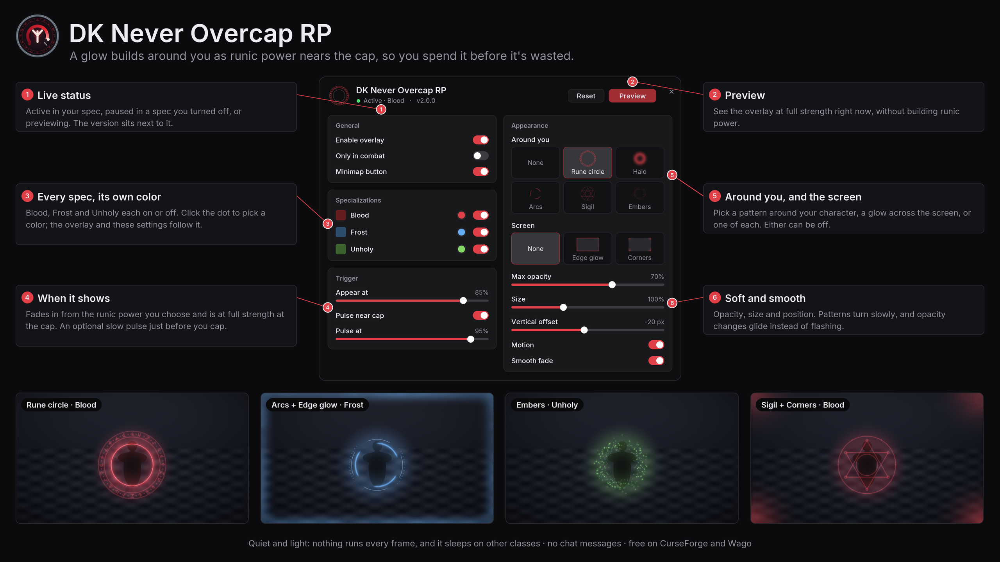

# DK Never Overcap RP

**Never waste runic power again.**

-1f6fb2)

DK Never Overcap RP draws a soft glow around your Death Knight as runic power nears the cap. It
is faint when it first appears and at full strength at the cap, so you know to spend before it's
wasted. There are no bars or numbers: you watch your character, and the glow tells you when.

## Highlights

- **Every Death Knight spec.** Blood, Frost and Unholy, each on or off, each with its own color.
- **Hand-drawn patterns.** Five around your character and two across the screen, in any
  combination.
- **Easy on the eyes.** Soft by default. Opacity glides instead of flashing, and the near-cap
  pulse is a slow breath.
- **Light by design.** Nothing runs every frame, and on other classes the addon does nothing at
  all after login.
- **Quiet.** No chat messages and no slash commands.

## Features

### The overlay

- **Builds with your runic power.** It appears at the share of max runic power you choose (85% by
  default) and reaches full strength at the cap.
- **Pulse near cap.** An optional slow pulse from a second threshold (95% by default), for the
  last moment to spend.
- **Smooth.** Opacity changes glide with a short ease, so spending and gaining runic power never
  looks like a flash.
- **Only in combat**, if you'd rather not see it while you move around town.
- **Works in Midnight combat**, where the game can hide runic power from addons.

### Patterns

Pick one pattern around your character, one across the screen, or one of each. Either can be off.

| Group | Patterns |
| --- | --- |
| Around you | **Rune circle** · **Halo** · **Arcs** · **Sigil** · **Embers** |
| Screen | **Edge glow** · **Corners** |

The patterns around you turn slowly and breathe. You can turn that motion off, and set their
size and height.

### Every spec, its own color

Blood, Frost and Unholy each have an on/off switch and a color. The overlay takes the color of
the spec you're in, and so do the settings window's accents. The defaults are a muted blood red,
frost blue and unholy green; click a color dot to pick your own.

### Settings window

- A compact, flat window with a live **Preview** that shows the overlay at full strength.
- A status line: active in your spec, paused in a spec you turned off, or previewing.
- Opens in combat, and stays out of the way of other addons' settings skins.

### Minimap button

- Left-click opens the settings, right-click turns the overlay on or off, drag moves the button.
- Gray while the overlay is off.
- Registers through LibDBIcon when another addon has loaded it, so minimap skins and button bars
  such as EllesmereUI handle it like any other launcher. Nothing is bundled for it.
- Shows only on Death Knights.

## Installation

### CurseForge and Wago

Install it with the CurseForge app or the Wago app, or download it from
[CurseForge](https://www.curseforge.com/projects/1695876) or
[Wago](https://addons.wago.io/addons/EGPa75N1).

### Manual

1. Download `DKNeverOvercapRP-<version>.zip` from the
   [latest release](https://github.com/powercover/DKNeverOvercapRP/releases/latest) on GitHub.
2. Extract it into `World of Warcraft/_retail_/Interface/AddOns/`, so that the `.toc` file ends up
   at `Interface/AddOns/DKNeverOvercapRP/DKNeverOvercapRP.toc`.
3. Restart the game and make sure **DK Never Overcap RP** is enabled in the AddOns list.

No other addons are required.

## Usage

| Where | Action |
| --- | --- |
| Minimap button, left-click | Open or close the settings window |
| Minimap button, right-click | Turn the overlay on or off |
| Minimap button, drag | Move the button around the minimap |
| Options → AddOns → DK Never Overcap RP | **Open settings** |
| Settings window, Esc or × | Close it |

Drag the settings window by any empty space to move it.

## Settings

| Section | Options | Default |
| --- | --- | --- |
| General | Enable overlay | On |
| | Only in combat | Off |
| | Minimap button | Shown |
| Specializations | Blood, Frost, Unholy: on/off and color | All on |
| Trigger | Appear at | 85% |
| | Pulse near cap, pulse at | On, 95% |
| Appearance | Around you | Rune circle |
| | Screen | None |
| | Max opacity | 70% |
| | Size | 100% |
| | Vertical offset | -20 px |
| | Motion | On |
| | Smooth fade | On |

**Reset** in the settings window restores the defaults and keeps the minimap button where you put
it. Settings are saved for your account.

## Performance

- **Not a Death Knight:** after login the addon registers no events, builds no overlay and runs
  nothing.
- **Spec turned off, or overlay off:** it only listens for spec changes.
- **Active:** it reacts to your runic power changing, and nothing else. The only frame-by-frame
  work is a short fade, which stops when it reaches its target, plus the pattern animations, which
  the game runs only while the overlay is visible.
- Pattern textures load only when you pick them, and the settings window is built the first time
  you open it.

## Compatibility

- Retail World of Warcraft 12.1.0, 12.1.5 and 12.1.7 (`Interface: 120100, 120105, 120107`). The addon doesn't
  load on Classic.
- Works with minimap button collectors and skins, such as EllesmereUI.
- The settings window uses the Inter font, which covers Latin and Cyrillic. Korean and Chinese
  clients use the game's own font.

## Known limitations

- If the game hides runic power from addons in combat, opacity changes there are instant instead
  of eased. The game itself works out the opacity, so the overlay still follows your runic power.
- English only.

## Reporting issues

Open an issue at [github.com/powercover/DKNeverOvercapRP/issues](https://github.com/powercover/DKNeverOvercapRP/issues)
and include:

- your game version (`/dump GetBuildInfo()`);
- your spec and the patterns you picked;
- any Lua error, for example from BugSack;
- a screenshot or short clip, if the problem is visual.

## Development

The addon is plain Lua with no libraries.

| File | Purpose |
| --- | --- |
| `Core.lua` | Saved settings, defaults, spec and runic power helpers |
| `Display.lua` | The overlay: patterns, colors, eased fades, the pulse and the event handling |
| `Options.lua` | The settings window and its Options → AddOns entry |
| `Minimap.lua` | The minimap button, through LibDBIcon when it's loaded |
| `Media/` | The overlay's and the window's textures, and the Inter font |

## License

Copyright © 2026 powercover. **All rights reserved.**

DK Never Overcap RP is free to download and use, but it isn't open source. You may use it,
unmodified, as an add-on for World of Warcraft. Redistributing it, publishing modified versions,
or reusing its code or art requires the author's written permission. See [LICENSE](LICENSE) for
the full terms.

The bundled Inter font is licensed separately under the SIL Open Font License 1.1
(`Media/Fonts/OFL.txt`).

World of Warcraft and Blizzard Entertainment are trademarks or registered trademarks of Blizzard
Entertainment, Inc. This addon is not affiliated with or endorsed by Blizzard Entertainment.

## Author

Made by **powercover**.
